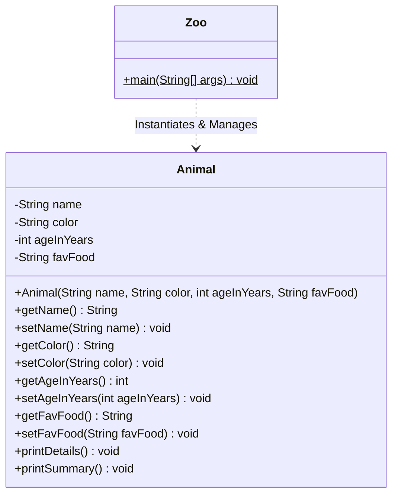

# Java OOP Animal Profile Manager

[](https://www.oracle.com/java/)
[](LICENSE)
[]()

A clean, object-oriented console application engineered in Java to demonstrate core OOP principles, encapsulation, custom constructor initialization, defensive data validation, formatted stream output (`printf`), and standard command-line user interaction with `Scanner`.

---

## 📋 Table of Contents

- [Overview](#overview)
- [Key Features](#key-features)
- [Software Architecture & Design](#software-architecture--design)
- [Core Skills Demonstrated](#core-skills-demonstrated)
- [Project Structure](#project-structure)
- [Getting Started](#getting-started)
  - [Prerequisites](#prerequisites)
  - [Compilation & Execution](#compilation--execution)
- [Sample Execution](#sample-execution)
- [License](#license)

---

## 🌟 Overview

The **Java OOP Animal Profile Manager** provides a structured system for creating, validating, and displaying zoo animal profiles. The application models real-world entity behavior through strict encapsulation, accessor/mutator patterns, and input stream buffer control to avoid common Scanner pitfalls in interactive CLI applications.

---

## ✨ Key Features

- **Strict Data Encapsulation**: Private field attributes (`name`, `color`, `ageInYears`, `favFood`) shielded behind public accessor and mutator methods.
- **Robust Constructor Initialization**: Parameterized constructor ensuring complete object state validity upon instantiation.
- **Defensive Boundary Validation**: Input sanitization guarding against negative age values.
- **Scanner Buffer Sanitization**: Clean handling of newline tokens (`\n`) following numerical input (`nextInt()`).
- **Structured Console Formatting**: Alignment and tabular profile rendering via `System.out.printf` format specifiers.

---

## 🏛️ Software Architecture & Design



---

## 🛠️ Core Skills Demonstrated

| Technical Competency | Description |
| :--- | :--- |
| **Object-Oriented Design** | Separation of domain model (`Animal`) from execution entrypoint (`Zoo`). |
| **Encapsulation & Access Modifiers** | Information hiding via `private` instance state and `public` accessors/mutators. |
| **Defensive Programming** | Boundary checks to ensure domain constraints (e.g., non-negative age enforcement). |
| **CLI Stream Management** | Managing `java.util.Scanner` stream consumption and memory lifecycle management (`close()`). |
| **Formatted I/O (`printf`)** | String template formatting with width-specified padding and line separators. |

---

## 📁 Project Structure

```text
java-oop-animal-profile-manager/
├── Animal.java         # Domain entity with state encapsulation and rendering logic
├── Zoo.java            # Main entrypoint handling CLI interaction and validation
├── .gitignore          # Git exclusion rules for Java binaries and IDE files
├── LICENSE             # MIT License
└── README.md           # Professional project documentation
```

---

## 🚀 Getting Started

### Prerequisites

- **Java Development Kit (JDK)**: Version 8 or higher (`javac` and `java` available in PATH).

### Compilation & Execution

1. **Clone the repository:**
   ```bash
   git clone https://github.com/<your-username>/java-oop-animal-profile-manager.git
   cd java-oop-animal-profile-manager
   ```

2. **Compile the Java source files:**
   ```bash
   javac Zoo.java Animal.java
   ```

3. **Run the application:**
   ```bash
   java Zoo
   ```

---

## 🖥️ Sample Execution

```text
Welcome to the Zoo Management System!
(Please enter the following details:)
================================

Enter the animal's name: Simba
Enter animal's color: Golden
Enter animal's age(Years): 5
Enter the animal's favorite food: Fresh Meat

===============================
       Zoo Animal Profile       
===============================

Name            : Simba
Color           : Golden
Age             : 5
Favourite Food  : Fresh Meat

===============================

Summary: Simba is Golden in color, 5 years old, and likes to eat Fresh Meat.
```

---

## 📄 License

This project is open-source and licensed under the [MIT License](LICENSE).
